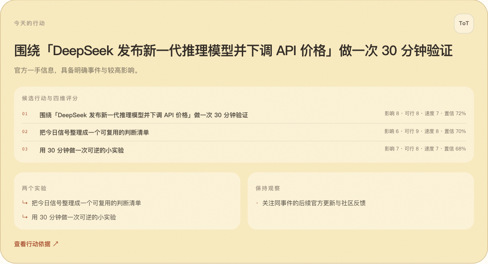

# Po Radar · AI News RSS

**中文** | [English](README_EN.md)

[](https://github.com/anthonyhann/ai-news-rss/actions/workflows/ci.yml)
[](LICENSE)
[](rust-toolchain.toml)
[](web/package.json)
[](CONTRIBUTING.md)
[](https://anthonyhann.github.io/ai-news-rss/)

Po Radar 是一个自托管的 AI 情报台，由原创陪伴角色 **Po** 担任主编。Rust 核心负责采集、去重、评分、简报和推送；React/Vite 负责可视化；SQLite 保存跨天状态。它不追求“给你更多链接”，而是把全网高信号信息压缩成一份可追溯、可行动、可双语阅读的每日简报。

> 第一次部署建议直接阅读 [配置 SOP](#配置-sop)，按顺序完成密钥、信源、验收和排障。


## 陪伴角色 Po


Po 采用项目提供的 IP 设定图：柑橘橙绒毛、奶油色脸和肚皮、珊瑚色耳内与脚掌，头顶还有一片叶子。圆润体量和极简豆豆眼承接奶龙式的 Q 感，也用“陪伴小伙伴”的亲和气质呼应天线宝宝小波的灵感。状态栏与信息流使用脸部特写，首页和简报使用全身像，以呼吸、轻浮和柔和阴影保持生命感。

### 软绒柑橘视觉系统

- **奶油燕麦 `#F7F1E8`**：页面画布与呼吸留白。
- **柑橘橙 `#F19A4B`**：Po、主强调与重要 CTA。
- **奶油白 `#F8E8CA`**：脸部、肚皮、卡片与正文阅读区。
- **珊瑚红 `#D96849`**：脚掌、链接、提醒与分数。
- **叶片绿 `#8A9A4B`**：信源健康、社区信号和次级状态。

动效只保留四种：角色 6 秒呼吸、6.5 秒轻浮、状态胶囊 210ms 展开、卡片 320ms 柔和进入。避免蓝紫渐变、强发光和大面积高饱和色，让工具保持可信度，同时保留绒毛玩具的温度。

## 为什么做这个项目

AI 信息散落在实验室博客、X、YouTube、Reddit、Hacker News、GitHub、Telegram、微信公众号 RSS 桥和 Newsletter 里。普通聚合器通常停在“这里还有更多链接”，Po Radar 增加了一层编辑判断：

- **先做确定性处理**：URL 规范化、内容哈希、64 位 SimHash，先清掉明显重复和近重复。
- **再做模型事件合并**：由模型判断 `same_event`、`follow_up`、`different_event`，避免把同一发布拆成多条。
- **主编评分**：相关性、影响力、新颖度、可信度、社区热度、可行动性共同形成 0–100 分。
- **双语简报**：标题、摘要和每日简报同时生成中文与英文版本。
- **输出行动**：用 Tree-of-Thoughts 生成今日 Top 1 行动、两个实验和一个观察项。
- **状态可迁移**：SQLite 既能本地运行，也能在 Docker 里运行，还能通过 GitHub Actions 的 `state` 分支保存。

## 功能

| 模块 | 已实现 |
|---|---|
| 信源 | RSS/Atom、Hacker News、Reddit、GitHub Releases、OSS Insight、Telegram、YouTube、arXiv、微信公众号 RSS 桥、X List |
| 去重 | 规范化 URL、SHA-256 内容哈希、SimHash 分桶、标题 Jaccard、模型事件合并 |
| 评分 | 0–100 编辑评分，含非 AI、传言、无原文链接、过期内容的硬上限 |
| 简报 | 中英双语、今日结论、Top Signals、背景知识、社区讨论、原文引用 |
| 行动 | 思维树生成 3–5 个候选行动，按影响、可行性、见效速度、置信度选择；候选评分在简报中公开可见 |
| 告警 | ≥90 分、置信度 ≥0.80、24 小时故事去重，支持实质性更新 |
| 推送 | 企业微信、飞书、钉钉、Telegram、邮件、网页发布 |
| Web | 今日雷达、每日简报、信源健康、高分告警、归档、方法页；中英切换后简报与归档按当前语言去重、搜索、过滤、收藏、深浅色 |
| 部署 | GitHub Actions + Pages、本地 CLI、Docker/Compose、axum API |
| 浏览器 | Actions/服务器用 Playwright worker；本机已登录浏览器用 ego-lite |

### 思维树行动建议

每日简报不只给结论，还会保留候选行动与四维评分摘要。系统选择一个主行动、两个可逆实验和一个观察项，每条建议都能回到证据链接；界面只展示可审计的评分摘要，不暴露隐藏推理。



## 信源覆盖

种子目录包含 **117 个逻辑信源**：

- 64 个 RSS/Atom：AI 实验室、公司、研究者、开发者工具和媒体。
- 20 个微信公众号 RSS 桥接源。
- 13 个 YouTube 频道。
- 11 个 Reddit 子版。
- 2 个公开 Telegram 频道。
- 3 个 GitHub Release feed。
- Hacker News、OSS Insight、arXiv，以及 1 个 X List 连接器。

X 连接器抓取的是一个 List，而不是一个账号一个请求。把目标 AI Builder 的 handles 放在 `config/sources/x.yaml`，将 `X_LIST_URL` 指向你创建的 X List 即可。一个 List 可以放入 300+ 个账号，但仍然只消耗一次浏览器采集。

原产品目标是 **370+ 信源**。这是一个目录目标：随着需要增加更多官方 feed、微信桥和 X handles。它不代表每两小时真的发起 370 个独立网络请求。

## 架构

```text
Sources
  RSS / HN / Reddit / GitHub / OSS Insight / Telegram / YouTube / WeChat / X
        │
        ▼
Stage 1：URL + 内容哈希 + SimHash + 标题 Jaccard
        │
        ▼
Stage 2：模型事件合并（same_event / follow_up / different_event）
        │
        ▼
Score：0–100 编辑评分 + 确定性硬上限
        │
        ├── ≥60 分 → 进入双语简报候选
        └── ≥90 分且置信度 ≥0.80 → 即时告警
        │
        ▼
Editor model → 中英双语简报 + 思维树行动建议
        │
        ▼
SQLite → 静态 JSON / Pages / axum API / 企业微信 / 飞书 / 钉钉 / Telegram / 邮件
```

主要目录：

- `src/sources/`：各来源连接器和统一 RawItem。
- `src/dedup.rs`：URL 规范化、分词、SimHash、Jaccard。
- `src/browser.rs`：Playwright / ego-lite X provider。
- `src/llm/`：OpenAI-compatible provider、mock provider、提示词契约。
- `src/pipeline/`：采集、评分、简报、告警、导出。
- `src/store/`：SQLite schema、查询、信源健康、合并状态。
- `web/`：React/Vite 仪表盘。
- `browser-worker/playwright-x.mjs`：无头 X List worker。

## 快速开始

环境要求：Rust 1.98.1+、Node.js 24+、pnpm 11+；Docker 可选。

```bash
cp .env.example .env

# 用 fixture 跑完整链路，不需要网络和 API Key
cargo run -- run --fixtures --slot morning

# 构建并预览网页
pnpm --dir web install
pnpm --dir web build
pnpm --dir web preview

# 本地 API + 静态站
cargo run -- serve
```

访问：

- `http://127.0.0.1:4173/`：Vite preview。
- `http://127.0.0.1:8080/`：axum server。

常用命令：

```bash
cargo run -- doctor
cargo run -- sources count
cargo run -- sources check
cargo run -- sources reset x-ai-builders
cargo run -- collect --only openai-blog
cargo run -- brief --slot evening
cargo run -- export
```

## 配置 SOP

目标：从空仓库开始，完成本地可运行、真实模型可用、X 可采集、飞书可推送、GitHub Actions 可部署。建议严格按顺序执行。

### 0. 配置文件地图

| 文件或目录 | 作用 | 是否提交 |
|---|---|---|
| `.env.example` | 所有密钥名称的模板 | 提交，不能填真实值 |
| `.env` | 本地真实密钥，CLI 启动时自动加载 | 不提交，已被 Git 忽略 |
| `config/app.toml` | 时区、模型预算、评分阈值、推送开关、浏览器参数 | 提交 |
| `config/sources/*.yaml` | 信源目录；按 RSS、社区、YouTube、微信、X 分类 | 提交 |
| `config/prompts/*.md` | 评分、去重、主编、双语、行动建议提示词 | 提交 |
| `.github/workflows/*.yml` | 采集、简报、Pages 和 CI 调度 | 提交 |

`.env`、`.env.*`、`cookies.json`、`storage-state*.json`、`*.pem`、`*.key` 已被 `.gitignore` 排除。GitHub Secrets 以加密形式保存在 GitHub，不会进入仓库或 Pages 静态文件。

### 1. 首次初始化

```bash
cp .env.example .env
chmod 600 .env
pnpm --dir web install
pnpm --dir browser-worker install
cargo run -- doctor
```

`doctor` 应显示 Node、Playwright worker、`yt-dlp` 可用，并列出信源数量。刚初始化时 `llm.configured=false` 是正常的，配置下文的 `LLM_API_KEY` 后会变为 `true`。

### 2. 配置 LLM

编辑 `.env`：

```dotenv
LLM_BASE_URL=https://api.deepseek.com/v1
LLM_API_KEY=sk-YOUR_KEY
LLM_SCORING_MODEL=deepseek-chat
LLM_EDITOR_MODEL=deepseek-chat
```

获取 `LLM_API_KEY`：登录 [DeepSeek 开放平台](https://platform.deepseek.com/api_keys) → 创建 API Key → 复制 `sk-...`。项目不绑定厂商，也可以换用任意 OpenAI-compatible 接口，只要同时修改 `LLM_BASE_URL` 和两个模型名。

ARK Agent Plan 的 OpenAI-compatible 数据面是 `https://ark.cn-beijing.volces.com/api/plan/v3`；直接使用 `/api/plan` 会返回 404，使用普通 `/api/v3` 会返回 401。

如果使用 GitHub-hosted Runner，请确认 Runner 所在网络能访问 ARK 中国区域端点；无法访问时运行会降级为 mock scorer。需要稳定真实模型时，使用自托管 Runner 或可访问的 OpenAI-compatible 网关。

验证：

```bash
cargo run -- doctor | jq '.llm'
```

看到 `"configured": true` 即配置成功。没有 `LLM_API_KEY` 时，采集仍会运行，但评分和简报使用 `mock-editor`，不能当作生产结果。

可在 `config/app.toml` 的 `[ai]` 调整成本：`max_items_per_run`、`max_editor_items`、`max_tokens_per_run` 和 `temperature`。建议先用默认值跑通，再根据 token 账单收紧。

### 3. 配置 X 采集

1. 在 X 的 **Lists** 中新建或打开目标 AI Builder 列表，把需要追踪的账号加入列表。
2. 复制列表 URL，例如 `https://x.com/i/lists/1234567890123456789`。
3. 用有权限访问该列表的账号登录 `x.com`。
4. 打开浏览器开发者工具 → Application → Storage → Cookies → `https://x.com`，复制 `auth_token` 和 `ct0`。
5. 在 `.env` 中填写：

```dotenv
X_LIST_URL=https://x.com/i/lists/1234567890123456789
TWITTER_AUTH_TOKEN=YOUR_AUTH_TOKEN
TWITTER_CT0=YOUR_CT0
TWITTER_PROXY=
```

私有列表必须使用同一账号的 Cookie；Cookie 失效后会报 `X browser session is not logged in`。如需代理，填写 `TWITTER_PROXY`。不建议把 Cookie 交给第三方，也不要提交到仓库。

验证：

```bash
cargo run -- collect --only x-ai-builders
cargo run -- sources check
```

X 单源失败只会记录健康状态，不会阻断 RSS/HN/Reddit/GitHub。可在 `config/app.toml` 的 `[browser]` 调整 `max_scrolls`、`scroll_delay_ms`、`timeout_ms`；不要盲目增大，以免触发风控。

如果账号没有现成的 X List，也可以把 `X_LIST_URL` 设为 `https://x.com/home`，worker 会采集该登录账号的首页时间线，再由 AI 评分层过滤非 AI 内容。

`TWITTER_PROXY` 应只在本地需要代理时填写；不要把 `127.0.0.1:7890` 这类本机地址配置成 GitHub Actions Secret，Runner 无法访问它。

GitHub-hosted Runner 的出口 IP 与 Easel 本机不同，X 可能拒绝该会话。若 Actions 返回 `X browser session is not logged in`，请使用自托管 Runner、目标网络可达的代理或官方 X API；Easel 登录态可直接用于本机运行。

### 4. 配置飞书推送

1. 进入飞书目标群 → 设置 → 群机器人 → 添加自定义机器人。
2. 复制 Webhook，例如 `https://open.feishu.cn/open-apis/bot/v2/hook/YOUR_HOOK`。
3. 当前适配器不发送签名。安全设置请选择“自定义关键词”或 IP 白名单；推荐关键词填 `AI`，因为高分提醒和简报正文都包含该词。
4. 写入 `.env`：

```dotenv
FEISHU_WEBHOOK_URL=https://open.feishu.cn/open-apis/bot/v2/hook/YOUR_HOOK
PUBLIC_SITE_URL=https://anthonyhann.github.io/ai-news-rss
```

`config/app.toml` 已设置 `[delivery.feishu] enabled = true`。启用其他渠道时，分别设置对应 `enabled = true` 并配置 `.env` 中的 URL、Token 或 SMTP 参数。

简报统一采用 **A · Po 晨读信**：60 秒摘要 → 今日头条 → 再看两条 → ToT 今日行动 → 完整简报入口。飞书发送交互卡片，企业微信/钉钉发送 Markdown，Telegram 发送 HTML，邮件发送中英合并在同一封的 600px 响应式 HTML。`PUBLIC_SITE_URL` 用于生成卡片与邮件里的“看完整简报”链接；Actions 中可用仓库变量覆盖，未设置时回落到本项目 Pages 地址。

可选连通性测试：

```bash
set -a; . ./.env; set +a
curl -fsS -X POST "$FEISHU_WEBHOOK_URL" \
  -H 'Content-Type: application/json' \
  -d '{"msg_type":"text","content":{"text":"AI Po Radar 配置测试"}}'
```

### 5. 同步 GitHub Actions Secrets

不要把真实值写进 workflow YAML。使用 GitHub CLI，命令会交互式提示输入值：

```bash
gh secret set LLM_BASE_URL --repo anthonyhann/ai-news-rss
gh secret set LLM_API_KEY --repo anthonyhann/ai-news-rss
gh secret set LLM_SCORING_MODEL --repo anthonyhann/ai-news-rss
gh secret set LLM_EDITOR_MODEL --repo anthonyhann/ai-news-rss
gh secret set X_LIST_URL --repo anthonyhann/ai-news-rss
gh secret set TWITTER_AUTH_TOKEN --repo anthonyhann/ai-news-rss
gh secret set TWITTER_CT0 --repo anthonyhann/ai-news-rss
gh secret set FEISHU_WEBHOOK_URL --repo anthonyhann/ai-news-rss
```

检查名称（只显示名称和时间，不显示值）：

```bash
gh secret list --repo anthonyhann/ai-news-rss
```

`TWITTER_PROXY` 只写入本机 `.env`。GitHub-hosted Runner 无法访问 `127.0.0.1` 代理；需要代理时请使用自托管 Runner 或指向 Runner 可访问的代理地址。

### 6. 配置信源、阈值与提示词

新增信源时，在 `config/sources/` 对应 YAML 中加入唯一 `id`：

```yaml
sources:
  - id: example-ai-blog
    kind: rss
    name: Example AI Blog
    url: https://example.com/feed.xml
    tier: 2
    lang: en
    category: model
    max_items: 20
    enabled: true
```

`tier` 越小可信度越高；暂时不用的信源设 `enabled: false`，不要删除目录。连续失败 5 次的信源会自动跳过，修复后用以下命令清除失败计数：

```bash
cargo run -- sources reset example-ai-blog
```

编辑阈值在 `config/app.toml` 的 `[pipeline]`：

- `digest_score`：进入简报的最低分，默认 60。
- `alert_score` / `alert_confidence`：即时提醒阈值，默认 90 / 0.80。
- `max_alerts_per_run`：单次最多提醒数，默认 3。
- `dedup_days`、`simhash_hamming`、`title_jaccard`：跨天去重严格度。
- `languages`：简报语言列表。

提示词在 `config/prompts/`。修改 `score.md`、`dedup.md`、`brief.md` 或 `action.md` 会影响下一次模型调用；建议先在 fixture 或单源采集中验证，再跑全量。

### 7. 启动与验收

按以下顺序验证，避免一上来就消耗完整模型预算：

```bash
# 1. 依赖与配置
cargo run -- doctor
cargo run -- sources count
cargo run -- sources check

# 2. 单源网络采集
cargo run -- collect --only openai-blog

# 3. 全量采集 + 评分
cargo run -- run --no-brief

# 4. 生成简报和行动建议
cargo run -- brief --slot morning

# 5. 导出静态数据并预览
cargo run -- export
pnpm --dir web build
pnpm --dir web preview
```

检查 `web/public/data/latest.json` 和 `actions.json` 是否包含 `action_plan`、简报和来源链接。GitHub Actions 调试时使用 `workflow_dispatch`，先看 Collect 日志，再触发 Digest，最后检查 Pages 页面。

### 8. 故障排查

| 现象 | 原因 | 处理 |
|---|---|---|
| `configured=false` 或输出 `mock-editor` | 未设置 `LLM_API_KEY`，或端点/模型为空 | 填写 `.env` 后运行 `doctor` |
| `X browser session is not logged in` | Cookie 过期或账号无权访问私有列表 | 重新获取 `auth_token` / `ct0` |
| X 源健康检查失败但其他源正常 | X 单源被隔离 | 检查 List URL、Cookie、代理 |
| 飞书无消息 | Webhook 缺失、关键词/签名不匹配 | 检查 `FEISHU_WEBHOOK_URL` 和机器人安全设置 |
| 没有简报 | 没有条目达到 `digest_score`，或未配置模型 | 查看运行统计和评分日志 |
| 信源被自动停用 | 连续失败 5 次 | 修复来源后执行 `sources reset` |
| Actions 无法写 `state` 分支 | workflow 权限不足或 state 分支保护 | 检查 `contents: write` 和分支规则 |
| 本地改了 `.env` 不生效 | 不在仓库根目录启动，或变量为空 | 在项目根目录重启命令 |

### 9. 安全规则

- 只把真实值放在 `.env` 或 GitHub Secrets，不写进 README、issue、日志和截图。
- 提交前检查 `git status` 和 `git diff`，确认没有 `.env`、Cookie、Webhook 或 API Key。
- 不要复用个人主账号 Cookie；优先使用专用账号或官方 API。
- 定期轮换 `LLM_API_KEY`、X Cookie、飞书 Webhook 和 SMTP 密码。
- 怀疑泄露时立即撤销旧密钥，再重新设置 Secret。

## 信源目录

信源文件在 `config/sources/`：

- `official.yaml`：实验室、AI 公司、研究机构、开发工具和媒体。
- `community.yaml`：Hacker News、Reddit、GitHub Releases、OSS Insight、Telegram。
- `youtube.yaml`：AI 频道和可选字幕采集。
- `wechat.yaml`：微信公众号 RSS 桥。
- `x.yaml`：X List 地址和种子 handles。

每个信源保留唯一 `id`。私密 URL 用 `${ENV_VAR}`，不要把密钥提交到仓库。

微信公众号没有稳定的直接公开接口。本项目只消费你自建的 RSS 桥（WeRSS、wechat2rss 等）。`WECHAT_RSS_BASE` 未配置时，这些信源会出现在健康检查失败列表，但不会阻塞其他来源。

## X：Playwright / ego-lite

### Playwright

```bash
pnpm --dir browser-worker install
pnpm --dir browser-worker exec playwright install chromium
```

在 `.env` 中设置 `X_LIST_URL`、`TWITTER_AUTH_TOKEN`、`TWITTER_CT0`，以及可选的 `TWITTER_PROXY`。worker 会注入 X cookies，也支持 Playwright `storageState` 或持久化 profile。这是 GitHub Actions 和服务器使用的路径。

### ego-lite

在本机已有登录态时：

```bash
ego-browser skill
EGO_BROWSER_ENABLED=1 cargo run -- collect
```

`provider = "auto"` 会在 `ego-browser` 存在且 `EGO_BROWSER_ENABLED=1` 时走 ego-lite，否则走 Playwright。ego-lite 使用你本机的浏览器登录态，不进入 GitHub Actions。

### 重要提醒

X 的自动化规则和风控会变化。生产环境建议使用专用小号或付费 API。X 采集失败会被隔离为单源健康失败，不会阻断 RSS/HN/Reddit/GitHub 的采集。

## GitHub Actions

- `.github/workflows/ci.yml`：fmt、clippy、test、前端构建、worker 语法检查。
- `.github/workflows/deploy.yml`：代码推送到 `main` 后从 `state` 分支恢复 SQLite，重新物化全部简报 JSON 并部署 Pages。
- `.github/workflows/collect.yml`：每 2 小时采集 + 评分，然后构建并部署静态站。
- `.github/workflows/digest.yml`：北京时间 08:20 / 20:20 生成中英双语简报和行动建议。

手动做单源 Smoke Test（例如只验证 X）：

```bash
gh workflow run collect.yml --repo anthonyhann/ai-news-rss -f only=x-ai-builders
```

工作流使用 **单提交 `state` 分支**保存 SQLite，避免主分支和历史仓库膨胀。公开仓库的 GitHub-hosted runner 分钟免费，但 LLM 调用、X/Playwright 代理和 YouTube 网络仍可能产生费用。

所需 Secrets 见 `.env.example` 和各 workflow 文件。永远不要提交 `.env`、`cookies.json`、`data/` 或 `web/public/data/`。

Secrets 的获取、写入和验收步骤统一见上方 **配置 SOP**。所有真实值只放在 `.env` 或 GitHub Secrets；仓库只保留无密钥的 `.env.example`。

## Docker

```bash
docker compose up -d --build
```

运行镜像基于官方 Playwright image，保留 X 自动化和 `yt-dlp` 能力。SQLite 保存在 `data/` volume，仪表盘由 `ainews serve` 提供，API 除可选 admin trigger 外均为只读。

## 评分与编辑规则

100 分制：

- AI 相关性：30
- 影响力：25
- 新颖度：15
- 来源可信度：15
- 社区热度：10
- 可行动性：5

硬上限：

- 非 AI 主题：59
- 未验证传言：69
- 无原始链接：50
- 重复或超过 7 天：30
- KOL/媒体转述官方发布：89

即时告警要求 ≥90 分且置信度 ≥0.80。同一 story 24 小时内默认不重复告警，除非分数发生实质性变化。简报只保留高信号内容并引用原文；站点不转载全文或完整字幕。

## 目录结构

```text
src/                 Rust pipeline、sources、LLM、store、server
web/                 React/Vite 仪表盘
browser-worker/      Playwright X List worker
config/sources/      YAML 信源目录
config/profiles/     编辑 profile 和权重
config/prompts/      评分、简报、去重、行动提示词
migrations/          SQLite schema
tests/fixtures/      确定性 fixture 数据
scripts/             Actions state restore/save
.github/workflows/   CI、采集、简报
Dockerfile           Playwright server image
```

## 测试

```bash
cargo fmt --all -- --check
cargo test
cargo clippy --all-targets -- -D warnings
pnpm --dir web build
pnpm --dir browser-worker exec node --check playwright-x.mjs
docker build --check .
```

Fixture 链路是确定性的：8 条原始信息去重后得到 7 个 story，最高分 93，生成 4 份中英双语简报。

## 贡献

请阅读 [CONTRIBUTING.md](CONTRIBUTING.md) 和 [CODE_OF_CONDUCT.md](CODE_OF_CONDUCT.md)。新增信源优先通过 YAML 完成；修改连接器时请补充 fixture；不要把密钥提交到仓库。

## 安全

不要用公开 issue 报告密钥或可利用漏洞。请阅读 [SECURITY.md](SECURITY.md)。

## License

MIT，详见 [LICENSE](LICENSE)。
