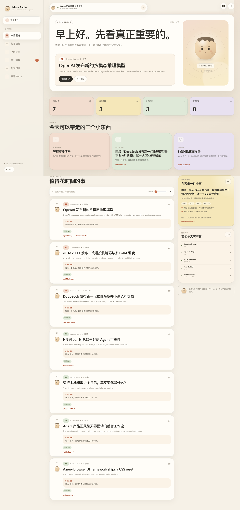

# Muse Radar · AI News RSS

**中文** | [English](README_EN.md)

[](https://github.com/anthonyhann/ai-news-rss/actions/workflows/ci.yml)
[](LICENSE)
[](rust-toolchain.toml)
[](web/package.json)
[](CONTRIBUTING.md)
[](https://anthonyhann.github.io/ai-news-rss/)

Muse Radar 是一个自托管的 AI 情报台。Rust 核心负责采集、去重、评分、简报和推送；React/Vite 负责可视化；SQLite 保存跨天状态。它不追求“给你更多链接”，而是把全网高信号信息压缩成一份可追溯、可行动、可双语阅读的每日简报。



## 为什么做这个项目

AI 信息散落在实验室博客、X、YouTube、Reddit、Hacker News、GitHub、Telegram、微信公众号 RSS 桥和 Newsletter 里。普通聚合器通常停在“这里还有更多链接”，Muse Radar 增加了一层编辑判断：

- **先做确定性处理**：URL 规范化、内容哈希、64 位 SimHash，先清掉明显重复和近重复。
- **再做模型事件合并**：由模型判断 `same_event`、`follow_up`、`different_event`，避免把同一发布拆成多条。
- **主编评分**：相关性、影响力、新颖度、可信度、社区热度、可行动性共同形成 0–100 分。
- **双语简报**：标题、摘要和每日简报同时生成中文与英文版本。
- **输出行动**：用 Tree-of-Thoughts 生成今日 Top 1 行动、两个实验和一个观察项。
- **状态可迁移**：SQLite 既能本地运行，也能在 Docker 里运行，还能通过 GitHub Actions 的 `state` 分支保存。

## 功能

| 模块 | 已实现 |
|---|---|
| 信源 | RSS/Atom、Hacker News、Reddit、GitHub Releases、OSS Insight、Telegram、YouTube、arXiv、微信公众号 RSS 桥、X List |
| 去重 | 规范化 URL、SHA-256 内容哈希、SimHash 分桶、标题 Jaccard、模型事件合并 |
| 评分 | 0–100 编辑评分，含非 AI、传言、无原文链接、过期内容的硬上限 |
| 简报 | 中英双语、今日结论、Top Signals、背景知识、社区讨论、原文引用 |
| 行动 | 思维树生成 3–5 个候选行动，按影响、可行性、见效速度、置信度选择；候选评分在简报中公开可见 |
| 告警 | ≥90 分、置信度 ≥0.80、24 小时故事去重，支持实质性更新 |
| 推送 | 企业微信、飞书、钉钉、Telegram、邮件、网页发布 |
| Web | 今日雷达、每日简报、信源健康、高分告警、归档、方法页；中英切换、搜索、过滤、收藏、深浅色 |
| 部署 | GitHub Actions + Pages、本地 CLI、Docker/Compose、axum API |
| 浏览器 | Actions/服务器用 Playwright worker；本机已登录浏览器用 ego-lite |

### 思维树行动建议

每日简报不只给结论，还会保留候选行动与四维评分摘要。系统选择一个主行动、两个可逆实验和一个观察项，每条建议都能回到证据链接；界面只展示可审计的评分摘要，不暴露隐藏推理。


## 信源覆盖

种子目录包含 **117 个逻辑信源**：

- 64 个 RSS/Atom：AI 实验室、公司、研究者、开发者工具和媒体。
- 20 个微信公众号 RSS 桥接源。
- 13 个 YouTube 频道。
- 11 个 Reddit 子版。
- 2 个公开 Telegram 频道。
- 3 个 GitHub Release feed。
- Hacker News、OSS Insight、arXiv，以及 1 个 X List 连接器。

X 连接器抓取的是一个 List，而不是一个账号一个请求。把目标 AI Builder 的 handles 放在 `config/sources/x.yaml`，将 `X_LIST_URL` 指向你创建的 X List 即可。一个 List 可以放入 300+ 个账号，但仍然只消耗一次浏览器采集。

原产品目标是 **370+ 信源**。这是一个目录目标：随着需要增加更多官方 feed、微信桥和 X handles。它不代表每两小时真的发起 370 个独立网络请求。

## 架构

```text
Sources
  RSS / HN / Reddit / GitHub / OSS Insight / Telegram / YouTube / WeChat / X
        │
        ▼
Stage 1：URL + 内容哈希 + SimHash + 标题 Jaccard
        │
        ▼
Stage 2：模型事件合并（same_event / follow_up / different_event）
        │
        ▼
Score：0–100 编辑评分 + 确定性硬上限
        │
        ├── ≥60 分 → 进入双语简报候选
        └── ≥90 分且置信度 ≥0.80 → 即时告警
        │
        ▼
Editor model → 中英双语简报 + 思维树行动建议
        │
        ▼
SQLite → 静态 JSON / Pages / axum API / 企业微信 / 飞书 / 钉钉 / Telegram / 邮件
```

主要目录：

- `src/sources/`：各来源连接器和统一 RawItem。
- `src/dedup.rs`：URL 规范化、分词、SimHash、Jaccard。
- `src/browser.rs`：Playwright / ego-lite X provider。
- `src/llm/`：OpenAI-compatible provider、mock provider、提示词契约。
- `src/pipeline/`：采集、评分、简报、告警、导出。
- `src/store/`：SQLite schema、查询、信源健康、合并状态。
- `web/`：React/Vite 仪表盘。
- `browser-worker/playwright-x.mjs`：无头 X List worker。

## 快速开始

环境要求：Rust 1.98.1+、Node.js 24+、pnpm 11+；Docker 可选。

```bash
cp .env.example .env

# 用 fixture 跑完整链路，不需要网络和 API Key
cargo run -- run --fixtures --slot morning

# 构建并预览网页
pnpm --dir web install
pnpm --dir web build
pnpm --dir web preview

# 本地 API + 静态站
cargo run -- serve
```

访问：

- `http://127.0.0.1:4173/`：Vite preview。
- `http://127.0.0.1:8080/`：axum server。

常用命令：

```bash
cargo run -- doctor
cargo run -- sources count
cargo run -- sources check
cargo run -- sources reset x-ai-builders
cargo run -- collect --only openai-blog
cargo run -- brief --slot evening
cargo run -- export
```

## 配置

运行配置在 `config/app.toml`。密钥放在 `.env` 或 GitHub Actions Secrets。

```dotenv
# 任意 OpenAI-compatible 接口
LLM_BASE_URL=https://api.deepseek.com/v1
LLM_API_KEY=
LLM_SCORING_MODEL=
LLM_EDITOR_MODEL=

# X List 采集
X_LIST_URL=https://x.com/i/lists/YOUR_LIST_ID
TWITTER_AUTH_TOKEN=
TWITTER_CT0=
TWITTER_PROXY=

# 微信公众号 RSS 桥
WECHAT_RSS_BASE=

# 推送
WECOM_WEBHOOK_URL=
FEISHU_WEBHOOK_URL=
DINGTALK_WEBHOOK_URL=
TELEGRAM_BOT_TOKEN=
TELEGRAM_CHAT_ID=
EMAIL_PASSWORD=
```

没有配置 LLM 时，fixture 和 `ALLOW_DEGRADED=true` 会使用确定性的 mock scorer。生产简报应配置真实模型。

## 信源目录

信源文件在 `config/sources/`：

- `official.yaml`：实验室、AI 公司、研究机构、开发工具和媒体。
- `community.yaml`：Hacker News、Reddit、GitHub Releases、OSS Insight、Telegram。
- `youtube.yaml`：AI 频道和可选字幕采集。
- `wechat.yaml`：微信公众号 RSS 桥。
- `x.yaml`：X List 地址和种子 handles。

每个信源保留唯一 `id`。私密 URL 用 `${ENV_VAR}`，不要把密钥提交到仓库。

微信公众号没有稳定的直接公开接口。本项目只消费你自建的 RSS 桥（WeRSS、wechat2rss 等）。`WECHAT_RSS_BASE` 未配置时，这些信源会出现在健康检查失败列表，但不会阻塞其他来源。

## X：Playwright / ego-lite

### Playwright

```bash
pnpm --dir browser-worker install
pnpm --dir browser-worker exec playwright install chromium
```

在 `.env` 中设置 `X_LIST_URL`、`TWITTER_AUTH_TOKEN`、`TWITTER_CT0`，以及可选的 `TWITTER_PROXY`。worker 会注入 X cookies，也支持 Playwright `storageState` 或持久化 profile。这是 GitHub Actions 和服务器使用的路径。

### ego-lite

在本机已有登录态时：

```bash
ego-browser skill
EGO_BROWSER_ENABLED=1 cargo run -- collect
```

`provider = "auto"` 会在 `ego-browser` 存在且 `EGO_BROWSER_ENABLED=1` 时走 ego-lite，否则走 Playwright。ego-lite 使用你本机的浏览器登录态，不进入 GitHub Actions。

### 重要提醒

X 的自动化规则和风控会变化。生产环境建议使用专用小号或付费 API。X 采集失败会被隔离为单源健康失败，不会阻断 RSS/HN/Reddit/GitHub 的采集。

## GitHub Actions

- `.github/workflows/ci.yml`：fmt、clippy、test、前端构建、worker 语法检查。
- `.github/workflows/collect.yml`：每 2 小时采集 + 评分，然后构建并部署静态站。
- `.github/workflows/digest.yml`：北京时间 08:20 / 20:20 生成中英双语简报和行动建议。

工作流使用 **单提交 `state` 分支**保存 SQLite，避免主分支和历史仓库膨胀。公开仓库的 GitHub-hosted runner 分钟免费，但 LLM 调用、X/Playwright 代理和 YouTube 网络仍可能产生费用。

所需 Secrets 见 `.env.example` 和各 workflow 文件。永远不要提交 `.env`、`cookies.json`、`data/` 或 `web/public/data/`。

## Docker

```bash
docker compose up -d --build
```

运行镜像基于官方 Playwright image，保留 X 自动化和 `yt-dlp` 能力。SQLite 保存在 `data/` volume，仪表盘由 `ainews serve` 提供，API 除可选 admin trigger 外均为只读。

## 评分与编辑规则

100 分制：

- AI 相关性：30
- 影响力：25
- 新颖度：15
- 来源可信度：15
- 社区热度：10
- 可行动性：5

硬上限：

- 非 AI 主题：59
- 未验证传言：69
- 无原始链接：50
- 重复或超过 7 天：30
- KOL/媒体转述官方发布：89

即时告警要求 ≥90 分且置信度 ≥0.80。同一 story 24 小时内默认不重复告警，除非分数发生实质性变化。简报只保留高信号内容并引用原文；站点不转载全文或完整字幕。

## 目录结构

```text
src/                 Rust pipeline、sources、LLM、store、server
web/                 React/Vite 仪表盘
browser-worker/      Playwright X List worker
config/sources/      YAML 信源目录
config/profiles/     编辑 profile 和权重
config/prompts/      评分、简报、去重、行动提示词
migrations/          SQLite schema
tests/fixtures/      确定性 fixture 数据
scripts/             Actions state restore/save
.github/workflows/   CI、采集、简报
Dockerfile           Playwright server image
```

## 测试

```bash
cargo fmt --all -- --check
cargo test
cargo clippy --all-targets -- -D warnings
pnpm --dir web build
pnpm --dir browser-worker exec node --check playwright-x.mjs
docker build --check .
```

Fixture 链路是确定性的：8 条原始信息去重后得到 7 个 story，最高分 93，生成 4 份中英双语简报。

## 贡献

请阅读 [CONTRIBUTING.md](CONTRIBUTING.md) 和 [CODE_OF_CONDUCT.md](CODE_OF_CONDUCT.md)。新增信源优先通过 YAML 完成；修改连接器时请补充 fixture；不要把密钥提交到仓库。

## 安全

不要用公开 issue 报告密钥或可利用漏洞。请阅读 [SECURITY.md](SECURITY.md)。

## License

MIT，详见 [LICENSE](LICENSE)。
