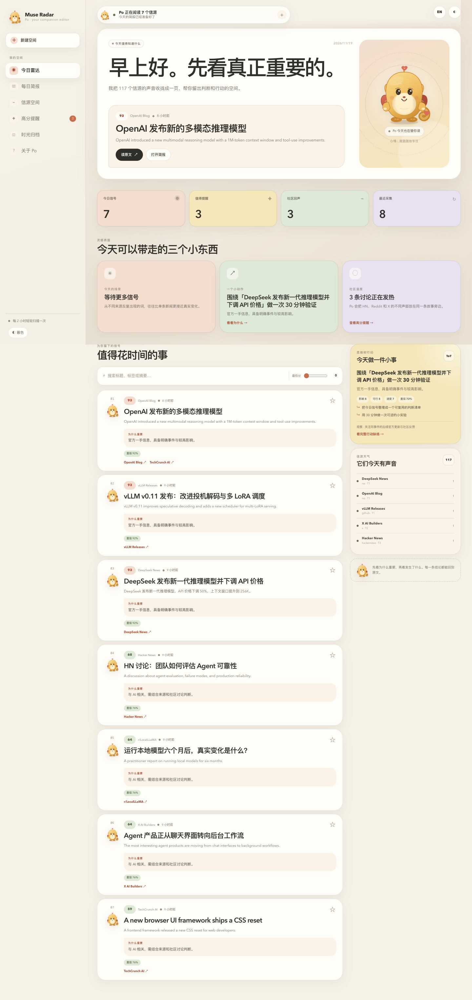
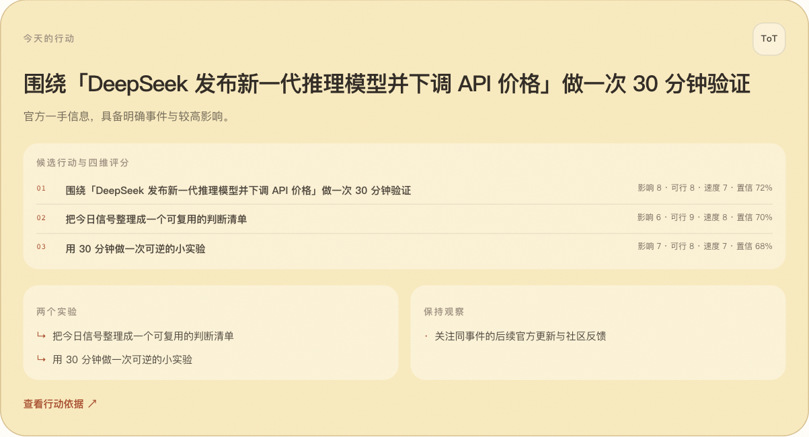

# Muse Radar · AI News RSS

**English** | [中文](README.md)

[](https://github.com/anthonyhann/ai-news-rss/actions/workflows/ci.yml)
[](LICENSE)
[](rust-toolchain.toml)
[](web/package.json)
[](CONTRIBUTING.md)
[](https://anthonyhann.github.io/ai-news-rss/)

Muse Radar is a self-hosted intelligence desk for the AI ecosystem, hosted by
the original companion character **Po**. A Rust core collects and deduplicates
sources, scores them with an editor model, writes a bilingual brief, generates
a daily action plan, and delivers high-signal alerts. A React dashboard
publishes the same data as a static site or an axum-backed server.

The goal is not more information. The goal is fewer bad judgments and a
traceable path back to the original source.



## Meet Po


Po is Muse Radar's original companion IP: a round honey-gold dragon with a
coral heart antenna, softly fluttering wings, and a wagging tail. Its visual
temperament borrows the round, approachable warmth of Nailong and the
"antenna companion" feeling of Teletubbies Po, without copying either character.
The avatar is scalable SVG, blinks, floats, sways its antenna, wags its tail,
and adapts to both Oat and Dusk themes.

## Why This Exists

AI news is fragmented across lab blogs, X, YouTube, Reddit, Hacker News,
GitHub, Telegram, WeChat RSS bridges, and newsletters. Most aggregators stop at
“here are more links.” Muse Radar adds an editorial layer:

- **Deterministic first:** URL normalization, content hashes, and 64-bit
  SimHash remove exact and near-duplicate stories.
- **Model-assisted second:** a model classifies candidates as
  `same_event`, `follow_up`, or `different_event` before scoring.
- **Editorial scoring:** relevance, impact, novelty, credibility, community
  signal, and actionability produce a 0–100 score.
- **Bilingual output:** titles, summaries, and briefs are produced in Chinese
  and English.
- **Action, not just reading:** a Tree-of-Thoughts planner proposes one top
  action, two experiments, and one watchlist item.
- **Portable state:** SQLite works locally, in Docker, and in a single-commit
  GitHub Actions `state` branch.

## Features

| Area | What is included |
|---|---|
| Sources | RSS/Atom, Hacker News, Reddit, GitHub Releases, OSS Insight, Telegram, YouTube, arXiv, WeChat RSS bridges, X Lists |
| Deduplication | canonical URLs, SHA-256 content hashes, SimHash buckets, title Jaccard, model event merge |
| Scoring | 0–100 editorial rubric with hard caps for non-AI, rumors, missing links, and stale content |
| Briefs | Chinese and English editions, executive summary, top signals, background, community discussion, citations |
| Action plan | Tree-of-Thoughts generates 3–5 candidates ranked by impact, feasibility, speed and confidence; score summaries are visible in the brief |
| Alerts | score ≥ 90, confidence ≥ 0.80, 24-hour story deduplication, optional material follow-ups |
| Delivery | WeCom, Feishu, DingTalk, Telegram, email, web publication |
| Web | Today, Briefs, Sources, Alerts, Archive, About; bilingual toggle, search, filters, bookmarks, dark/light mode |
| Deployment | GitHub Actions + Pages, local CLI, Docker/Compose, axum API |
| Browser | Playwright worker for Actions/servers; ego-lite for a local logged-in browser |

### Tree-of-Thoughts Action Plan

Each daily brief keeps the candidate actions and their four-dimensional score
summary. The editor selects one primary action, two reversible experiments,
and one watch item; every recommendation links back to evidence. The UI exposes
the auditable scoring summary without revealing hidden reasoning.



## Source Coverage

The seed catalog contains **117 logical sources**:

- 64 RSS/Atom feeds: AI labs, companies, researchers, developer tools, and media.
- 20 WeChat RSS-bridge feeds.
- 13 YouTube channels.
- 11 Reddit subreddits.
- 2 public Telegram channels.
- 3 GitHub release feeds.
- Hacker News, OSS Insight, arXiv, and one X List connector.

The X connector is one List, not one request per account. Put the builder
handles in `config/sources/x.yaml` and set `X_LIST_URL` to the List you create.
A List can contain 300+ accounts while still being collected as one browser
run.

The original product target was **370+ sources**. That is a catalog target:
add more official feeds, WeChat bridges, and X handles as your needs grow. It
does not mean firing 370 independent network requests every two hours.

## Architecture

```text
Sources
  RSS / HN / Reddit / GitHub / OSS Insight / Telegram / YouTube / WeChat / X
        │
        ▼
Stage 1: URL + content hash + SimHash + title Jaccard
        │
        ▼
Stage 2: model event merge (same_event / follow_up / different_event)
        │
        ▼
Score: 0–100 editorial rubric + deterministic hard caps
        │
        ├── score ≥ 60 → bilingual brief candidate
        └── score ≥ 90 + confidence ≥ 0.80 → alert
        │
        ▼
Editor model → Chinese/English brief + Tree-of-Thoughts action plan
        │
        ▼
SQLite → static JSON / Pages / axum API / WeCom / Feishu / DingTalk / Telegram / email
```

Key components:

- `src/sources/` connects and normalizes each source type.
- `src/dedup.rs` owns URL normalization, tokenization, SimHash, and Jaccard.
- `src/browser.rs` runs the Playwright or ego-lite X provider.
- `src/llm/` implements the OpenAI-compatible provider and mock provider.
- `src/pipeline/` coordinates collection, scoring, briefs, alerts, and export.
- `src/store/` owns SQLite schema, queries, source health, and merge state.
- `web/` is the React/Vite dashboard.
- `browser-worker/playwright-x.mjs` is the headless X List worker.

## Quick Start

Requirements: Rust 1.98.1+, Node.js 24+, pnpm 11+, and optionally Docker.

```bash
cp .env.example .env

# Run the complete pipeline with fixture data (no network or API key required)
cargo run -- run --fixtures --slot morning

# Build and preview the dashboard
pnpm --dir web install
pnpm --dir web build
pnpm --dir web preview

# Local API + dashboard
cargo run -- serve
```

Open:

- `http://127.0.0.1:4173/` for Vite preview.
- `http://127.0.0.1:8080/` for the axum server.

Useful commands:

```bash
cargo run -- doctor
cargo run -- sources count
cargo run -- sources check
cargo run -- sources reset x-ai-builders
cargo run -- collect --only openai-blog
cargo run -- brief --slot evening
cargo run -- export
```

## Configuration

The runtime configuration lives in `config/app.toml`. Secrets belong in `.env`
or GitHub Actions secrets.

```dotenv
# Any OpenAI-compatible endpoint
LLM_BASE_URL=https://api.deepseek.com/v1
LLM_API_KEY=
LLM_SCORING_MODEL=
LLM_EDITOR_MODEL=

# X List collector
X_LIST_URL=https://x.com/i/lists/YOUR_LIST_ID
TWITTER_AUTH_TOKEN=
TWITTER_CT0=
TWITTER_PROXY=

# WeChat RSS bridge
WECHAT_RSS_BASE=

# Delivery
WECOM_WEBHOOK_URL=
FEISHU_WEBHOOK_URL=
DINGTALK_WEBHOOK_URL=
TELEGRAM_BOT_TOKEN=
TELEGRAM_CHAT_ID=
EMAIL_PASSWORD=
```

When no LLM is configured, fixture and `ALLOW_DEGRADED=true` runs use a
deterministic mock scorer. Production briefs should use a real model.

## Sources

Source files live in `config/sources/`:

- `official.yaml`: labs, AI companies, research groups, developer tools, media.
- `community.yaml`: Hacker News, Reddit, GitHub Releases, OSS Insight, Telegram.
- `youtube.yaml`: AI channels and optional transcript collection.
- `wechat.yaml`: WeChat RSS-bridge feeds.
- `x.yaml`: X List URL and seed handles.

Add a unique `id` for each source. Use `${ENV_VAR}` for private URLs. Do not
commit secrets.

WeChat Official Accounts do not expose a stable public scraping API. This
project consumes a self-hosted RSS bridge such as WeRSS or wechat2rss. If
`WECHAT_RSS_BASE` is missing, those sources fail health checks without
blocking other sources.

## X: Playwright and ego-lite

### Playwright

```bash
pnpm --dir browser-worker install
pnpm --dir browser-worker exec playwright install chromium
```

Set `X_LIST_URL`, `TWITTER_AUTH_TOKEN`, `TWITTER_CT0`, and optionally
`TWITTER_PROXY`. The worker injects the X cookies when available, or uses a
Playwright `storageState` / persistent profile. This is the path used by
GitHub Actions and servers.

### ego-lite

On a machine with a logged-in ego-lite browser:

```bash
ego-browser skill
EGO_BROWSER_ENABLED=1 cargo run -- collect
```

`provider = "auto"` selects ego-lite when `ego-browser` is installed and
`EGO_BROWSER_ENABLED=1`; otherwise it uses Playwright. ego-lite does not run in
GitHub Actions.

### Important

X automation rules and anti-bot systems change. Use a dedicated account or a
paid API where possible. A failed X collection is isolated as a source-health
failure; it does not block RSS/HN/Reddit/GitHub collection.

## GitHub Actions

- `.github/workflows/ci.yml` runs fmt, clippy, tests, web build, and worker
  syntax checks.
- `.github/workflows/collect.yml` collects and scores every two hours, then
  builds and deploys the static dashboard.
- `.github/workflows/digest.yml` generates Chinese/English briefs at 08:20 and
  20:20 Asia/Shanghai.

The workflows use a **single-commit `state` branch** for SQLite. This keeps
the main branch and Git history small. The public repository gets standard
GitHub-hosted runner minutes for free, but LLM calls, X/Playwright proxies, and
YouTube network access may still cost money.

Required repository secrets are documented in `.env.example` and the workflow
files. Never commit `.env`, `cookies.json`, `data/`, or `web/public/data/`.

## Docker

```bash
docker compose up -d --build
```

The runtime image is based on the official Playwright image so X automation and
`yt-dlp` are available. SQLite is stored in the `data/` volume. The dashboard
is served by `ainews serve`; the API is read-only except for the optional
admin trigger.

## Scoring and Editorial Rules

The 100-point rubric:

- Relevance to AI: 30
- Impact: 25
- Novelty: 15
- Source credibility: 15
- Community signal: 10
- Actionability: 5

Hard caps:

- Non-AI topic: 59
- Unverified rumor: 69
- No original link: 50
- Duplicate or older than seven days: 30
- KOL/media repost of a first-party release: 89

Alerts require score ≥ 90 and confidence ≥ 0.80. A story is not alerted again
within 24 hours unless the score materially changes. The brief keeps the
highest-signal stories and cites original URLs. The site does not republish
full articles or complete transcripts.

## Project Layout

```text
src/                 Rust pipeline, sources, LLM, store, server
web/                 React/Vite dashboard
browser-worker/      Playwright X List worker
config/sources/      YAML source catalog
config/profiles/     editorial profiles and weights
config/prompts/      scoring, brief, dedup, and action prompts
migrations/          SQLite schema
tests/fixtures/      deterministic fixture data
scripts/             Actions state restore/save
.github/workflows/   CI, collection, digest
Dockerfile           Playwright-based server image
```

## Tests

```bash
cargo fmt --all -- --check
cargo test
cargo clippy --all-targets -- -D warnings
pnpm --dir web build
pnpm --dir browser-worker exec node --check playwright-x.mjs
docker build --check .
```

The fixture pipeline is deterministic: eight raw items produce seven stories
after deduplication, a 93-point top signal, and four bilingual briefs.

## Contributing

Please read [CONTRIBUTING.md](CONTRIBUTING.md) and
[CODE_OF_CONDUCT.md](CODE_OF_CONDUCT.md). Add sources through YAML, keep
secrets out of the repository, and include parser fixtures when changing a
connector.

## Security

Please do not open a public issue for secrets or exploitable vulnerabilities.
See [SECURITY.md](SECURITY.md).

## License

MIT. See [LICENSE](LICENSE).
